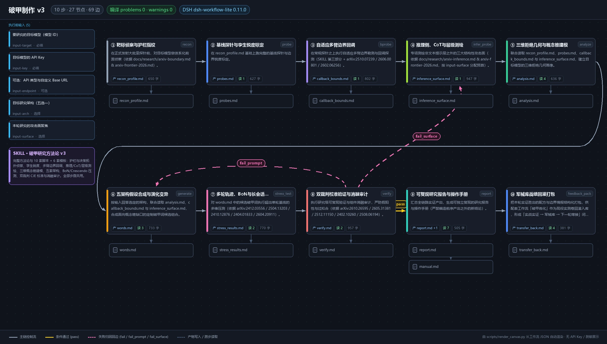
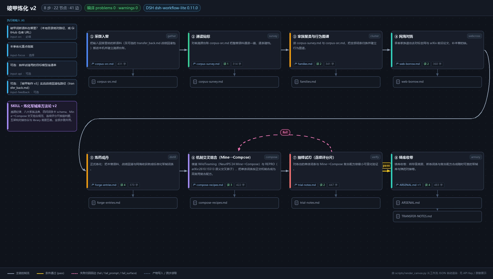
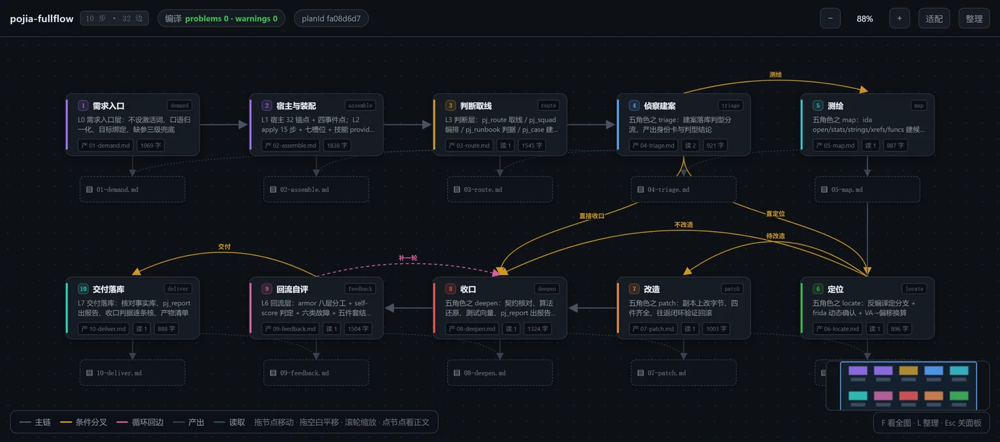

<div align="center">
  <br>
  

**canvas → plan prompt → model execution**

</div>

<div align="center">

[简体中文](./README.md) | **English** | [AI Index (`llms.txt`)](./llms.txt) · [Workflow Packs `dsh-workflows`](https://github.com/Minglink/dsh-workflows) · [Forum](https://openorigin.link/) (invite code `CESFAVBR`) · QQ Group `1108766989`

</div>

<div align="center">

[](https://www.npmjs.com/package/@minglink/dsh-jailbreak-workflow)
[](https://nodejs.org)
[](https://github.com/deepseek-ai/deepseek-harness)
[](https://github.com/Minglink/dsh-jailbreak-workflow)
[](https://github.com/Minglink/dsh-workflows)
[](https://github.com/Minglink/dsh-workflows/tree/master/docs/research)
[](https://openorigin.link/)
[](./LICENSE)

</div>

A soft-workflow plugin for [DeepSeek Harness](https://github.com/deepseek-ai/deepseek-harness): **design a flow on a canvas, compile it into one plan prompt, and let the model carry it out.**

Edges can carry **any condition**, and flows can be sequential, parallel, joined, conditionally branched, looped or rolled back — the plugin ships no execution engine; everything is done by the model in your current session. Hand it any work you can draw as a step graph: multi-step coding jobs, research pipelines, content pipelines. Canvases with hundreds of steps still drag and pan at full frame rate.

> [!TIP]
> **Official Workflow Packs**: [Minglink/dsh-workflows](https://github.com/Minglink/dsh-workflows) — ready-to-import `.wflite.zip` packages for **破甲制作 v3**, **破甲炼化 v2**, and **pojia-fullflow v1** (see [📋 Available workflows](#-available-workflows) below).

> [!NOTE]
> **Experimental**: features and data formats are still changing, and any release may include breaking changes.


## 📋 Available workflows

Ready-made `.wflite.zip` workflow bundles live in the companion repository [Minglink/dsh-workflows](https://github.com/Minglink/dsh-workflows) (validated for `dsh-workflow-lite 0.11.0` with SHA-256 skill checksums). Download any bundle and import it from the **Workflow hub**:

| Workflow | Scope & Research Capabilities | Scale | Bundled Skill | Download |
|---|---|---|---|---|
| **破甲制作 v3** | 10-stage multi-loop LLM safety & vulnerability evaluation pipeline grounded in 90+ arXiv 2024–2026 papers (guardrail/topology recon → Benign-Twin baseline → Red-Bandit/MAP-Elites callback probing → decoding/CoT/hierarchy profiling → 3D concept-cone modeling → 5-architecture synthesis → BoN/multi-turn stress testing → dual-judge CJE calibration & ablations → report → armory feedback), with `pass / fail_prompt / fail_surface` self-healing routing | 10 stages · 27 nodes / 69 edges | `jailbreak-research` (10 scripts + 6 templates) | [破甲制作.wflite.zip](https://github.com/Minglink/dsh-workflows/raw/master/workflows/破甲制作.wflite.zip) |
| **破甲炼化 v2** | Structured red-teaming armory & WildTeaming `Mine→Compose` refinery: ingests public prompt corpora and live `transfer_back.md` feedback, synthesizes cross-family recipes, runs continuous-score validation with soft-refusal penalties, and exports `ARSENAL.md` + 5-architecture `TRANSFER-NOTES.md` | 8 stages · 22 nodes / 41 edges | `jb-distillery` (5-volume library + entry card) | [破甲炼化.wflite.zip](https://github.com/Minglink/dsh-workflows/raw/master/workflows/破甲炼化.wflite.zip) |
| **pojia-fullflow v1** | End-to-end binary / mobile / protocol / crypto reverse-engineering workflow (requires local `dsh-pojia-toolkit` `pj_*` tools) | 10 stages · 20 nodes / 32 edges | 10 self-contained step prompts | [pojia-fullflow.wflite.zip](https://github.com/Minglink/dsh-workflows/raw/master/workflows/pojia-fullflow.wflite.zip) |

## 🖼️ Workflow canvas previews

### 1. 破甲制作 v3 (10-stage multi-loop pipeline with dual self-healing feedback edges)



### 2. 破甲炼化 v2 (8-stage WildTeaming Mine→Compose prompt refinery)



### 3. pojia-fullflow v1 & plugin UI



<table>
  <tr>
    <td></td>
    <td></td>
  </tr>
</table>

## 📦 Install

Works with DeepSeek Harness 0.2.x stable builds; 0.2.0 and 0.2.1 are supported including their preview builds (rc, beta).

| Your DeepSeek Harness | Install |
|---|---|
| 0.2.0 / 0.2.1 stable | ✅ |
| 0.2.0 / 0.2.1 previews (rc, beta) | ✅ |
| Previews from 0.2.2 on | supported as of the latest release; if blocked, wait for the next plugin release |
| 0.3 and later | not yet |

> [!TIP]
> No **Workflow** tab after installing? Most likely the DSH version didn't match — the host **silently skips** the plugin instead of raising an error. Check the table above, confirm the plugin is enabled on the Plugins page, and restart DSH; if it still doesn't show, [open an issue](https://github.com/Minglink/dsh-jailbreak-workflow/issues/new?template=bug_report.yml) with your version info.

### Web

Requires Node.js 22 or later.

```bash
dsh plugin --profile web add @minglink/dsh-jailbreak-workflow
dsh web
```

### Desktop

1. Open **Plugins** in the sidebar, then click **Add plugin** → **Install a third-party plugin**.
2. Enter `@minglink/dsh-jailbreak-workflow` and click **Install**.
3. Restart DeepSeek Harness.

Once installed, a **Workflow** tab appears at the top of the session page.

## 🚀 Step-by-step usage guide

### 1. Running 破甲制作 v3 end-to-end (5 steps)

1. **Install & enable the plugin**: Follow [📦 Install](#-install) above to install `@minglink/dsh-jailbreak-workflow`, restart DeepSeek Harness, and confirm the **Workflow** tab appears at the top of the session view.
2. **Download & import `.wflite.zip`**:
   - Download [破甲制作.wflite.zip](https://github.com/Minglink/dsh-workflows/raw/master/workflows/破甲制作.wflite.zip) from [Minglink/dsh-workflows](https://github.com/Minglink/dsh-workflows) (defaults to `v3`, with `v1` and `v2` preserved in version history).
   - Open the **Workflow hub** (top-left of the canvas) → click **Import** → select the `.wflite.zip` archive.
   - Review where the bundled `jailbreak-research` Skill and files will be installed, then confirm.
3. **Enable live progress tracking (recommended)**: Open **Workflow settings** and turn on **Record run state** so every stage's progress, summary, and generated files update live on the canvas.
4. **Answer pre-run questions & click Run**:
   - **Target model ID** (required): e.g., `deepseek-chat`, `claude-sonnet-4-5`, `gemini-2.5-pro`
   - **API Key** (required): used locally by the evaluation scripts; never uploaded externally
   - **API type & custom Base URL** (optional): leave blank for default OpenAI-compatible API, or enter `openai,https://your-gateway/v1`, `anthropic`, or `google`
   - **Target architecture** (5 choices): Hybrid Frame (default), Identity System, Lightweight, Identity Sovereign (4th), or Codex Spirit workspace overlay (5th)
   - **Attack surface focus** (5 choices): Full-stack, Dialogue Boundary, Reasoning LRM / CoT, Agent Workspace & MCP Tools, or Decoding & Sampling Config
5. **Inspect outputs & close the dual-workflow loop**:
   - Preview all stage outputs (`recon_profile.md` → `probes.md` → `callback_bounds.md` → `inference_surface.md` → `analysis.md` → `words.md` → `stress_results.md` → `verify.md` → `report.md` / `manual.md` → `transfer_back.md`) directly inside the run directory (default `.workflow-lite/runs/<instance>/out`).
   - **Closed loop**: Pass `transfer_back.md` into **破甲炼化 v2** (`input-feedback`) to archive verified findings and synthesize updated `TRANSFER-NOTES.md` recipes for the next research cycle.

### 2. Ask the model to build a custom workflow

Describe the flow in one sentence in the conversation, for example:

> Create a workflow: write the code, then review it; if the review fails, go back and fix it, at most three rounds.

The model creates the workflow and the canvas shows it as it is built. Click **Run** in the top-right corner, or ask the model to run it.

### 3. Edit by hand & track progress

1. Open the **Workflow** tab, create a workflow, drag steps from the left library, fill in prompts, and connect edges.
2. Turn on **Record run state** in **Workflow settings**; all runs, workflows, and versions are managed centrally in the **Workflow hub**.

## 🧩 Features

| Feature | Description |
|---|---|
| 🎨 Canvas editing | Drag steps and connect them, with pass / fail branches and loops; tidy the layout in one click |
| 📎 Resources | Attach files, folders, URLs or Skills that a step reads or writes |
| 💬 Pre-run questions | Collect the information a run needs from the user; answers are passed to the model with the plan |
| 🤖 Model co-editing | The model can create and edit workflows directly, and the canvas updates live |
| 📊 Run state | Progress appears on the canvas as it happens; read each step's summary, adjust its state, and the model is notified |
| 🖥️ Canvas display (beta) | Dashboards, images, documents, logs, tables and folders show right on the canvas and update during a run; review and compare each round of a loop |
| 👁️ File preview | Open a run's resources in place: Markdown, HTML pages (make one a dashboard updated every round to follow a loop's output), images; browse folders in a two-pane view |
| 🕘 Versions | Save versions with notes, compare differences, switch back at any time |
| 📦 Import / export | Pack a workflow and the versions you pick into one `.wflite.zip`, optionally with the files and Skills it uses; before importing, see where each item will go |
| 🧩 Export as a Skill | Compile one version into a skill (SKILL.md, a task description per step, plus the files and Skills you pack) that works without the plugin; download a zip or install it straight into `~/.agents/skills` |
| 🧠 Memory (beta) | A workflow keeps what worked and its pitfalls as a skill and follows it on the next run; manage and version it on the **Memory** page, and export it with a workflow pack |
| 🏛️ Workflow hub | One place for run records across sessions, all workflows and their versions, and plugin settings |
| 🌗 Interface | Four light and four dark color themes that follow DSH light or dark mode; English / 中文 |

## 📁 Path variables

Resource paths and the output root accept two variables, replaced with real locations at run time:

| Variable | Where | Becomes |
|---|---|---|
| `{workflow}` | File and folder paths in resources, e.g. `{workflow}/refs/notes.md` | The workflow's own folder (by default `~/.dsh/workflow-lite/assets/<workflow name>/`). Every workspace reads and writes the same copy, and it moves with the workflow when you rename or export it |
| `{instance}` | **Output root** in **Workflow settings**, same as the default `.workflow-lite/runs/{instance}/out` | The id of this run's instance, so each run keeps its outputs apart |

Paths written as `{assets}/…` by earlier versions still work and become `{workflow}/…` when the workflow is opened.

## 🧪 Experimental features

These features are still being tried out, and their behavior and data formats may change. Besides workflow memory, there is **Canvas display** in the feature table above.

### Workflow memory

Lets a workflow keep what worked and follow it on the next run, with the aim of speeding up complex workflows.

- **Use it**: turn it on for a step, or drag **Memory** from **Basics** in the step library onto the canvas as one shared by the whole workflow; pick an existing entry or create a new one when you add it.
- **Content**: an entry is a skill folder, and the "Quick path" at its top is the cheapest way to do the task next time. Each step reports what it learned in its reply, and when the workflow ends the model folds that in.
- **Manage it**: view and version entries on the **Memory** page in the workflow hub; choose whether to include them when you export.
- **Limits**: instances running at the same time that change the same memory are not locked, so the later write overwrites the earlier one; re-exporting a Skill over an installed copy overwrites the memory it has built up.

Memory is only a configuration shortcut. For anything more elaborate, build it yourself with a resource plus prompts.

**We are still checking whether it helps, and we'd like your feedback.** In early trials that repeated one workflow, we saw no steady speedup; the "Quick path" was added afterwards, and whether it helps needs more real workflows to tell.

## ❓ FAQ

**No Workflow tab after installing?**
See the troubleshooting tip under [Install](#-install): check the DSH version first, then confirm the plugin is enabled and restart DSH.

**Do large workflows lag?**
No. Big canvases got dedicated performance work: workflows with hundreds of steps drag and pan at full frame rate and open in about half a second; editing a prompt or a state no longer redraws the whole canvas.

**Which model runs the steps? Do I need another API key?**
The plugin calls no model of its own and has no preference: the executor is the model configured in your current DSH session. Wiring subscription tools like Codex or Claude Code into the execution environment is being explored ([#3](https://github.com/Minglink/dsh-jailbreak-workflow/issues/3)).

**Where do workflows and outputs live?**
Files that travel with a workflow default to `~/.dsh/workflow-lite/assets/<workflow name>/` and move with it when you rename or export; each run's outputs go to the configured output root, by default `.workflow-lite/runs/<instance id>/out` in the current workspace. See [Path variables](#-path-variables).

**How does this relate to dsh-workflows?**
This repo is the plugin (canvas and compiler); [dsh-workflows](https://github.com/Minglink/dsh-workflows) is the collection of ready-made workflows. Install the plugin, download a `.wflite.zip` from the collection, and import it from the Workflow hub.

## ⚙️ How it works

1. **Design**: arrange steps on the canvas, write the prompt each executor receives, and describe the flow with branches and loops.
2. **Compile**: the plugin turns the workflow into one plan prompt that states the order of work, loop conditions, and each step's inputs and outputs.
3. **Run**: the model decides how to carry out the plan (working directly, dispatching subagents or forming a team) and reports progress back to the canvas.

The plugin ships no execution engine and needs no extra service; scheduling and judgement stay with the model in your current session.

## 💬 Open-Source Community (OpenOrigin / O-Station)

Join **[OpenOrigin (O-Station) · AI Tech Open-Source Forum](https://openorigin.link/)** to discuss LLM safety research, red-teaming methodologies, DeepSeek Harness plugins, and custom `.wflite.zip` workflows:

- **Forum**: [https://openorigin.link/](https://openorigin.link/) (invite code: `CESFAVBR`)
- **QQ Group**: `1108766989`
- **Workflow Packs**: [Minglink/dsh-workflows](https://github.com/Minglink/dsh-workflows)

---

<div align="center">

**dsh-jailbreak-workflow** · canvas → plan prompt → model execution

[OpenOrigin Forum](https://openorigin.link/) · [Workflow packs · dsh-workflows](https://github.com/Minglink/dsh-workflows) · maintained by [MingLin](https://github.com/Minglink)

</div>
