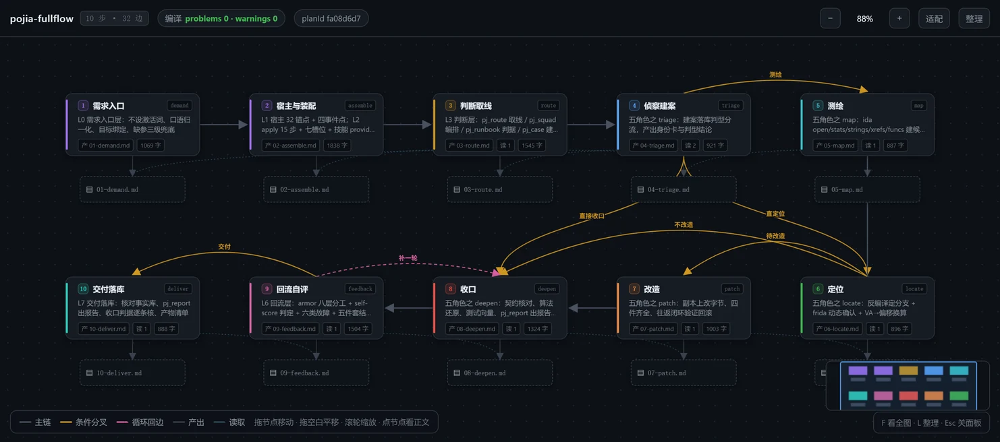
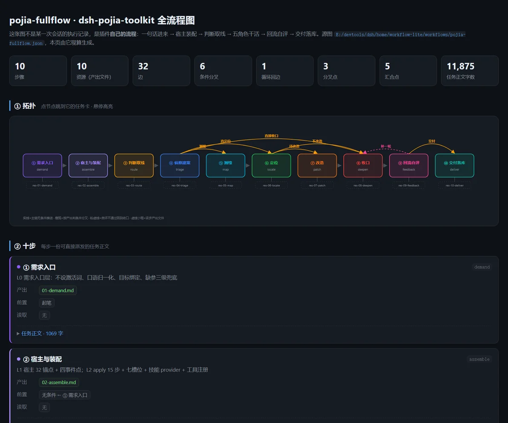

<div align="center">
  <br>
  

**画布 → 计划提示词 → 模型执行**

</div>

<div align="center">

简体中文 | [English](./README.en.md) · [破甲技术交流论坛](https://openorigin.link/)（邀请码 `CESFAVBR`）· QQ 群 `1135498706`

[](https://www.npmjs.com/package/@minglink/dsh-jailbreak-workflow) [](https://nodejs.org) [](https://github.com/deepseek-ai/deepseek-harness) [](https://github.com/Minglink/dsh-workflows)

</div>

[DeepSeek Harness](https://github.com/deepseek-ai/deepseek-harness) 的软工作流插件：**在画布上设计流程，编译成一份计划提示词，交给模型按计划执行。**

连线可以带**任意条件**，顺序、并行、汇合、分支、循环、回退全都支持——插件里没有执行引擎，一切由当前会话中的模型完成。适合把能画成步骤图的活都交给它跑：多步编码任务、研究流水线、内容生产流水线；几百步的大图拖拽、平移照样满帧。

> [!TIP]
> **工作流合集**：[Minglink/dsh-workflows](https://github.com/Minglink/dsh-workflows)——现成的 `.wflite.zip` 工作流包，下载导入即用，已上架「破甲制作」研究流水线与「pojia-fullflow」逆向全流程（见下文 [📋 支持的工作流](#-支持的工作流)）。

> [!NOTE]
> **实验阶段**：功能和数据格式仍在调整，后续任何版本都可能包含不兼容的改动。


## 📋 支持的工作流

现成的工作流放在工作流合集 [Minglink/dsh-workflows](https://github.com/Minglink/dsh-workflows) 里，下载 `.wflite.zip` 后在「**工作流中心**」导入即可运行。

| 工作流 | 说明 | 下载 |
|---|---|---|
| **破甲制作** | LLM 破甲研究自动化流水线，15 步：**探针测试**（200+ 探针，覆盖身份系统 / 混合帧 / 轻量三种架构）→ **拒绝模式分析** → **定制破甲词生成** → **API 验证** → **三件套输出**（破甲词文件 + 使用手册（帧矩阵 + 推回词库）+ 研究报告）。内置 `jailbreak-research` Skill：10 个测试脚本 + 4 套提示词模板 | [破甲制作.wflite.zip](https://github.com/Minglink/dsh-workflows/raw/master/workflows/破甲制作.wflite.zip) |
| **pojia-fullflow** | 破甲逆向全流程，10 步 32 条边：**需求入口 → 宿主与装配 → 判断取线 → 侦察建案 → 测绘 / 定位 → 改造 → 收口 → 回流自评 → 交付落库**，三处按证据分叉、一条回到「收口」的循环边，覆盖 27 条工作流 / 167 个阶段。**依赖本机 `dsh-pojia-toolkit` 插件提供的 `pj_*` 工具** | [pojia-fullflow.wflite.zip](https://github.com/Minglink/dsh-workflows/raw/master/workflows/pojia-fullflow.wflite.zip) |

## 🖼️ 工作流示例

### 破甲制作

「破甲制作」研究流水线在画布上的样子——15 个步骤串成一条流水线，分支、循环和产出文件都直接画在图上。


<table>
  <tr>
    <td></td>
    <td></td>
  </tr>
</table>

### pojia-fullflow

「pojia-fullflow」走的是逆向全流程：10 个步骤、32 条边串成一条主线，三处按证据分叉、一处回到「收口」循环一轮，从「一句话需求」推到可交付结论，每步的正文就是可以直接派发的任务文本。





每一步都调 `dsh-pojia-toolkit` 的 `pj_*` 工具（取线、编排、建案、反编译、改字节、出报告等 20 个）。没装这个本机插件，图画得出来但一步也跑不动；纯提示词版可以把这 10 步的结构自己拖一张，把每步的任务正文当提示词用。


## 📦 安装

适配 DeepSeek Harness 0.2.x 的正式版；0.2.0 与 0.2.1 连预览版（rc、beta）一起支持。

| 你的 DeepSeek Harness | 能否安装 |
|---|---|
| 0.2.0 / 0.2.1 正式版 | ✅ 直接装 |
| 0.2.0 / 0.2.1 预览版（rc、beta） | ✅ 直接装 |
| 0.2.2 起的预览版 | 以当期支持为准，装不上等插件跟进一步 |
| 0.3 及以上 | 尚未适配 |

> [!TIP]
> 装完没出现「工作流」标签页：多半是 DSH 版本对不上——宿主对不上时会**静默跳过**插件，不报错。先核对上表，再到「插件」页确认插件已启用、重启 DSH；还不行就带版本信息[提 issue](https://github.com/Minglink/dsh-jailbreak-workflow/issues/new?template=bug_report.yml)。

### 网页版

需要 Node.js 22 及以上。

```bash
dsh plugin --profile web add @minglink/dsh-jailbreak-workflow
dsh web
```

### 桌面端

1. 在侧边栏打开「**插件**」，点击「**添加插件**」→「**安装第三方插件**」。
2. 填入 `@minglink/dsh-jailbreak-workflow`，点击「**安装**」。
3. 重启 DeepSeek Harness。

安装完成后，会话页顶部会出现「**工作流**」标签页。

## 🚀 使用

### 让模型创建

在对话中用一句话描述流程，例如：

> 建一个工作流：先写代码，再审查，审查不通过就回去修复，最多三轮。

模型会创建工作流，画布上会同步显示。检查无误后，点击右上角「**执行**」，或让模型直接执行。

### 手动编辑

1. 打开「工作流」标签页，新建一个工作流。
2. 从左侧步骤库将步骤拖到画布上，填写提示词并连线。
3. 点击右上角「**执行**」，或在对话中请模型执行该工作流。

### 跟踪进度

在「工作流设置」中开启「**记录运行状态**」，此后每次执行都会生成一条记录，画布随进度更新。执行记录、工作流与版本统一在画布左上角的「**工作流中心**」中管理。

## 🧩 功能

| 功能 | 说明 |
|---|---|
| 🎨 画布编辑 | 拖拽步骤与连线，支持「通过 / 不通过」分支和循环，一键整理布局 |
| 📎 资源 | 为步骤指定要读写的文件、文件夹、网址或 Skill |
| 💬 执行前提问 | 执行前向用户收集必要信息，答案随计划交给模型 |
| 🤖 模型协作编辑 | 模型可以直接创建、修改工作流，画布实时同步 |
| 📊 运行状态 | 执行进度实时显示在画布上；可查看每一步的摘要、调整状态并通知模型 |
| 🖥️ 画布展示（实验性） | 看板、图片、文档、日志、表格和文件夹直接显示在画布上，执行时自动更新；循环每一轮的产出可以回看、对比 |
| 👁️ 文件预览 | 实例里的资源点开就能看：Markdown、HTML 页面（可做成每轮更新的看板，随时查看循环产出）、图片；文件夹分左右两栏浏览 |
| 🕘 版本管理 | 保存版本、添加说明、对比差异、随时切换 |
| 📦 导入导出 | 把工作流和选中的版本打成一个 `.wflite.zip`，可以连同用到的文件与 Skill 一起打包；导入前列出每样东西放到哪 |
| 🧩 导出成 Skill | 把一个版本编译成 skill（SKILL.md + 每步的任务描述 + 打包的文件与 Skill），不装插件也能用；下载 zip，或直接装到本机的 `~/.agents/skills` |
| 🧠 记忆（实验性） | 工作流把跑通的做法和踩过的坑记成 skill，下次执行照着走；可以在「记忆」页管理、存版本，随工作流包导出 |
| 🏛️ 工作流中心 | 集中管理各会话的执行记录、全部工作流与版本，以及插件设置 |
| 🌗 界面 | 浅色、深色各四套配色主题，跟随 DSH 自动切换；中文 / English |

## 📁 路径变量

资源里的路径和产出根目录可以写下面两个变量，执行时换成实际的位置：

| 变量 | 写在哪 | 换成什么 |
|---|---|---|
| `{workflow}` | 资源里的文件、文件夹路径，如 `{workflow}/refs/notes.md` | 这个工作流自己的目录（默认 `~/.dsh/workflow-lite/assets/<工作流名>/`）。在哪个工作区执行都读写同一份，工作流改名、导出时一起带走 |
| `{instance}` | 「工作流设置」里的「产出根目录」，如默认值 `.workflow-lite/runs/{instance}/out` | 这次执行的实例 id，每次执行的产出各放一处 |

旧版本写的 `{assets}/…` 照样能用，打开工作流时会自动改成 `{workflow}/…`。

## 🧪 实验性功能

下面的功能还在试验，行为和数据格式后续可能调整；除了工作流记忆，还有上面功能表里的「画布展示」。

### 工作流记忆

让工作流把跑通的做法记下来，下次执行照着走，目的是加快复杂工作流的执行。

- **使用**：给步骤开一份，或从步骤库「基础」里把「记忆」拖到画布上，作为整个工作流共用的一份；加的时候选已有的，或新建。
- **内容**：一条记忆是一个 skill 文件夹，开头的「快速路径」是下次最省事的走法。各步骤把经验写在回复里，工作流结束时由模型整理进去。
- **管理**：在工作流中心的「记忆」页查看、存版本；导出时可选带不带。
- **限制**：多个实例同时改同一条记忆不加锁，后写的覆盖先写的；重新导出并覆盖安装 Skill，会覆盖已装 skill 里攒下的记忆。

记忆只是一个快捷配置。需要更复杂的玩法时，建议自己用「资源」加提示词实现。

**效果还在验证，欢迎反馈。** 早期在同一个工作流上重复执行的试验里没有看到稳定的提速，后来加入了「快速路径」，是否有用需要更多真实的工作流来检验。

## ❓ 常见问题

**装完没有「工作流」标签页？**
见[安装](#-安装)一节的排查提示：先核对 DSH 版本，再确认插件已启用并重启 DSH。

**步骤很多的工作流会卡吗？**
不会。大图专门优化过：几百个步骤的工作流拖拽、平移保持满帧，打开约半秒；改提示词、改状态时画布不再整张重算。

**执行用的是哪个模型？要另配 API 吗？**
插件自己不调用模型，也不挑模型：执行者是当前 DSH 会话里配置的模型。把 Codex、Claude Code 这类订阅工具接进执行环境的想法正在跟进（[#3](https://github.com/Minglink/dsh-jailbreak-workflow/issues/3)）。

**工作流和产出存在哪里？**
跟随工作流的文件默认在 `~/.dsh/workflow-lite/assets/<工作流名>/`，改名、导出时一起带走；每次执行的产出按「产出根目录」落盘，默认是当前工作区的 `.workflow-lite/runs/<实例>/out`。详见[路径变量](#-路径变量)。

**它和 dsh-workflows 什么关系？**
本仓库是插件（画布与编译），[dsh-workflows](https://github.com/Minglink/dsh-workflows) 是现成工作流合集；装好插件后从合集下载 `.wflite.zip`，在「工作流中心」导入即用。

## ⚙️ 工作原理

1. **设计**：在画布上编排步骤，为每一步写好交给执行者的提示词，用分支和循环描述流程。
2. **编译**：插件把工作流整理成一份计划提示词，写明执行顺序、循环条件、每一步的输入与产出。
3. **执行**：模型按计划自行安排执行方式（直接完成、派发子代理或组建团队），并把进度同步回画布。

插件本身不包含执行引擎，也无需额外服务；调度与判断交由当前会话中的模型完成。

---

<div align="center">

**dsh-jailbreak-workflow** · 画布 → 计划提示词 → 模型执行

[工作流合集 dsh-workflows](https://github.com/Minglink/dsh-workflows) · 维护者 [MingLin](https://github.com/Minglink)

</div>
